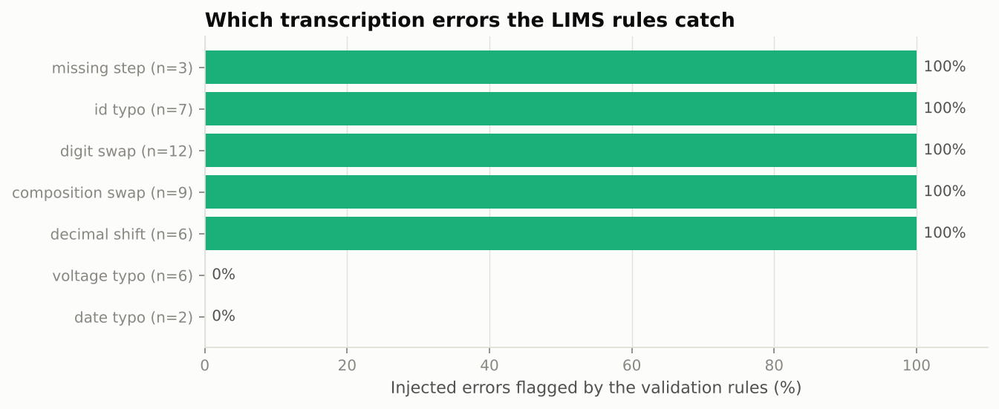
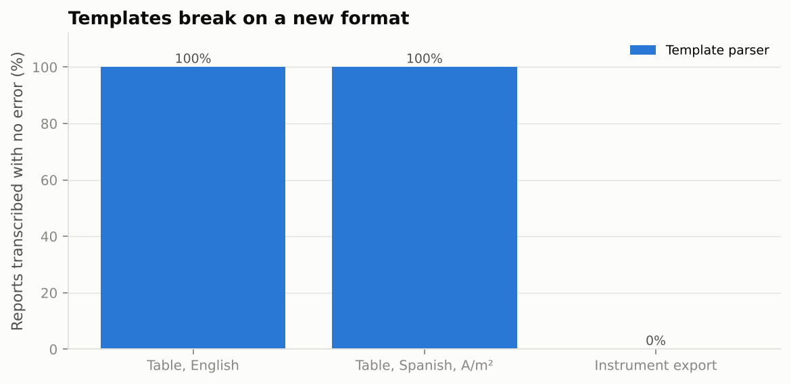

# Lab Report Copilot: From PDF Test Reports to Validated LIMS Records

[](https://github.com/c4r0l13/lab-report-copilot/actions/workflows/ci.yml)


Laboratories receive results as PDFs, in formats that change with every instrument and partner lab. Someone types them into the LIMS, and transcription errors become "data". This project builds and measures the pipeline that replaces that step:

**PDF → extraction (template parser or Claude) → domain validation rules → repair loop → auto-accept or human review**

The numbers in every report are **real**: 442 CO2 electrolysis test results from [Open Catalyst Experiments 2024](https://arxiv.org/abs/2411.11783). The PDF formats and the transcription errors are generated, so the ground truth of every field is known.

> *Resumen en español:* copiloto que convierte reportes de laboratorio en PDF en registros de LIMS validados. Compara un parser por plantillas con Claude, aplica reglas de validación de dominio (balance de eficiencia faradaica, protocolo completo, rangos, muestra registrada) y mide cuántos errores de transcripción se detectan y cuántos registros se aceptan automáticamente sin error.

## Results so far

| | Result |
|---|---|
| Rows in the raw lab export that are not measurements (avg/std summary rows) | **2,760 of 5,412 (51%)** |
| Mean CO2R cell voltage, naive vs measurements only | 2.54 V vs **3.41 V** |
| Real test records flagged by the rules | 28 of 442 (Faradaic efficiency above 100%, missing voltage, voltage drops) |
| Injected transcription errors caught by the rules (perfect reading) | **82%** (37 of 45) |
| False alarms on clean documents (perfect reading) | **0%** |
| Template parser: reports transcribed with no error | 100% on known formats, **0% on a new format** |

## 1. Audit of the real lab export

Before extracting anything, the rules were run on the source data itself:

- **Half the rows are not measurements.** The export mixes replicate rows (`rep` = 1, 2, 3) with `avg` and `std` summary rows in the same columns. Averaging the voltage column directly gives 2.54 V, because standard deviations (about 0.03 V) are averaged in as if they were voltages. The correct mean is 3.41 V.
- **46 measurement steps report a total Faradaic efficiency above 100.5% or a negative liquid fraction.** Physically impossible, so these are measurement or post-processing artefacts that should be reviewed, not modelled.
- **5 steps have no voltage** and **6 replicates show the cell voltage falling as current increases**, which usually means a step was mislabelled.

None of this is unusual for real lab data. It is exactly what a LIMS should catch on arrival.

## 2. The validation rules

| Rule | What it catches |
|---|---|
| `unknown_sample` | Sample ID not registered in the LIMS (typos, wrong batch) |
| `composition_mismatch` / `composition_sum` | Reported composition differs from the registered sample, or fractions don't sum to 1 |
| `incomplete_protocol` | A current-density step is missing (protocol: 50, 100, 150, 200, 300 mA/cm²) |
| `voltage_range` | Cell voltage outside 1.5–5.0 V (unit or decimal errors) |
| `gas_balance` | H2 + CO + CH4 + C2H4 does not add up to the reported gas total (±1 point) |
| `fe_over_unity` | Gas + liquid Faradaic efficiency above 100.5%, or negative |
| `voltage_not_monotonic` | Voltage drops by more than 0.05 V as current increases |



On a perfect transcription the rules catch every error that breaks physics or bookkeeping, and raise no false alarms on clean documents. They **cannot** catch errors that stay plausible: two swapped digits in a voltage (3.412 → 3.421 V) or a wrong day in the batch date. Those need either a second reading or the instrument file itself, which is the honest limit of rule-based checking.

## 3. Extraction: templates vs Claude

150 reports are generated from randomly chosen real records in three formats: an English table, a Spanish table in SI units (A/m², dates as DD/MM/YYYY), and a raw potentiostat export (voltages in mV, Faradaic efficiencies as fractions). 45 of them (30%) contain one injected transcription error.



The **template parser** is perfect on the two formats it was written for and reads nothing from the third. That is what happens in a real lab when a new instrument arrives. Its failures are safe (every unreadable report is flagged), but a third of the work goes back to a person.

The **Claude extractor** (`src/labcopilot/extract.py`):

- uses a strict tool schema, so every answer has the same structure as the LIMS record;
- is told to *transcribe, not correct*: a wrong number in the PDF must stay wrong in the record, so the rules can flag it for the lab instead of hiding it;
- normalises units (A/m² → mA/cm², mV → V, fractions → %);
- gets **one repair turn** when a rule fails. It re-reads the document and fixes a misreading, or keeps the value if the document really says so;
- caches every response on disk, so results are reproducible and a rerun costs nothing.

To run it (about 150 short calls with the default `claude-haiku-5-5`; set `LABCOPILOT_MODEL` to compare models):

```bash
export ANTHROPIC_API_KEY=...        # PowerShell: $env:ANTHROPIC_API_KEY="..."
make run-llm
```

The run adds the Claude columns to the figures and reports these metrics in `reports/metrics.json`: reports transcribed with no error by format, injected errors caught, false alarms, **straight-through rate** (records accepted with no human) and **wrong records accepted**. The last one is the number a lab manager cares about.

## How to run

```bash
make install
make data      # raw OCx24 export (~1 MB) and sample registry, pinned commit
make run       # template parser + rules, no API key needed (~20 s)
make test      # includes the Claude repair loop with a fake client
```

## Project structure

```
lab-report-copilot/
├── src/labcopilot/
│   ├── data.py        # raw export → one record per sample replicate; audit of the raw table
│   ├── validate.py    # LIMS rules
│   ├── render.py      # three PDF formats + seven kinds of transcription error
│   ├── extract.py     # PDF text, template parser, Claude extractor with repair turn and cache
│   ├── evaluate.py    # field-by-field comparison with the truth
│   └── pipeline.py    # corpus, runs, metrics, figures
├── tests/             # rules, round trips, error kinds, LLM repair loop (fake client)
└── reports/           # metrics.json, per_document.csv, figures/, llm_outputs/ (cached responses)
```

## Why this project

I implemented LIMS and ELN systems for laboratories across Latin America before moving into data science and generative AI. The hard part was never the software: it was getting correct data in. This project is the tool I wanted then: GenAI does the reading, and the chemistry and the lab protocol decide what can be trusted.

## Data and credits

Abed, J. et al. (2024). *Open Catalyst Experiments 2024 (OCx24): Bridging Experiments and Computational Models.* [arXiv:2411.11783](https://arxiv.org/abs/2411.11783). Raw data from the [fairchem repository](https://github.com/FAIR-Chem/fairchem/tree/main/src/fairchem/applications/ocx) (MIT License). The report layouts, lab names and transcription errors in this project are generated for evaluation and are not real documents.
